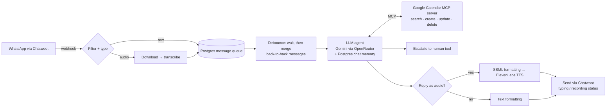

# n8n AI Agents

Production-style **AI agents built around n8n**:

| Agent | Channel | Folder |
|---|---|---|
| **WhatsApp Clinic Receptionist**: books on Google Calendar over MCP, voice notes in and out | WhatsApp (async) | [`workflows/`](workflows) |
| **Voice Receptionist (pt-PT)**: inbound calls with barge-in, authenticated and idempotent booking tools | Voice / web (real time) | [`voice-receptionist/`](voice-receptionist) |
| **MCP Server: Google Calendar**: calendar operations as reusable agent tools | MCP | [`workflows/`](workflows) |

> Sanitized demo versions: fictitious clinic, no credentials, no hosts, no IDs. Every value you must
> configure is marked `<YOUR_...>` or read from environment variables.

## WhatsApp Clinic Receptionist

Engineering details:
- **Debounced inbox.** Patients often send three short messages in a row. Messages are queued in Postgres,
  the workflow waits a few seconds and processes them as one turn, so the agent doesn't answer three times.
- **Tools over MCP.** Calendar operations live in a separate MCP server workflow, so any agent can reuse them.
- **Voice in, voice out.** Audio messages are transcribed. Replies can be generated as natural speech
  (SSML + ElevenLabs) when the patient prefers audio.
- **Guardrails in the prompt and in tools.** The agent never confirms a booking before the calendar tool returns
  success, never gives medical opinions, and escalates unhappy patients or out-of-scope topics to a human.
- **UX signals.** It marks messages as read and shows "typing…" / "recording…" while the agent works.

## MCP Server: Google Calendar

A 6-node workflow that publishes Google Calendar operations (search, list, create, update, delete) as
tools through n8n's MCP Server Trigger.

## Setup

1. Import both JSON files from `workflows/` into n8n.
2. Create credentials in n8n: Postgres, OpenRouter, OpenAI (transcription), ElevenLabs (HTTP header auth),
   Chatwoot and Google Calendar OAuth.
3. Set the `CHATWOOT_API_TOKEN` environment variable, then fill in the `Info` node
   (Chatwoot URL, Telegram chat id for escalations).
4. Point the agent's MCP client at your MCP server URL, and replace `<YOUR_CALENDAR_ID>` in the prompt.

## Stack

n8n · LLM agents (OpenRouter / Gemini) · MCP · Postgres · Chatwoot · ElevenLabs · OpenAI Whisper · Google Calendar
