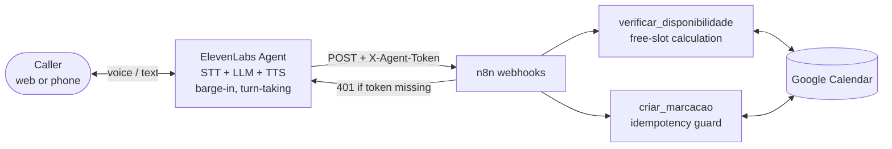

# Voice Receptionist (pt-PT)

An inbound **voice agent** for a medical clinic that speaks **European Portuguese**. It greets the caller,
works out the intent, collects the patient's details, checks real calendar availability and books the
appointment, with support for **interruptions (barge-in)** and refusal of off-script requests.
Works over voice and text.

> Sanitized version of a demo I designed and validated. Fictitious clinic and data, no agent IDs, hosts or tokens.

## Architecture



**Split of responsibilities.** The voice platform owns the conversation (speech-to-text, LLM, speech,
turn-taking). n8n owns the **business logic**, exposed as two small, authenticated tools. The conversation
layer can be swapped (Retell, Vapi) without touching the scheduling rules.

## Engineering decisions

| Topic | Decision |
|---|---|
| **Platform** | Compared ElevenLabs Agents, Retell and Vapi. Picked ElevenLabs for a native pt-PT voice and built-in barge-in: fewer moving parts and lower latency for a first inbound call. |
| **Model choice is a test result, not a default** | The first LLM collapsed while **dictating phone numbers digit by digit**. Switching models fixed it. Each candidate was evaluated against the same test script. |
| **Idempotent booking** | Voice agents call tools twice (a caller corrects a detail after confirming, or the model retries after a slow response). `criar_marcacao` checks the day's events by normalized name and phone, and returns the existing booking instead of creating a duplicate. See [`src/booking-guard.js`](src/booking-guard.js). |
| **Deterministic availability** | The model never invents times. Slots are computed from the calendar with opening hours, lunch break, period filter and "no past times". Three options are spread across the period, because reading three consecutive slots on a call is useless. See [`src/slots.js`](src/slots.js). |
| **Authenticated tools** | Every webhook checks a shared header and answers **401 before touching the calendar**. Verified over HTTP: no header → 401, valid header → 200, booking without header → 401 with no event created. |
| **Language guardrails** | The prompt enforces pt-PT vocabulary ("marcação", "utente", "telemóvel") and bans Brazilian terms, because a "Portuguese" voice does not guarantee European Portuguese. |
| **Safety** | No diagnoses, no medical opinions, no booking past dates or with incomplete phone numbers, and no confirmation before the tool returns success. |

## Files

| File | What it is |
|---|---|
| [`system-prompt.pt-PT.md`](system-prompt.pt-PT.md) | Full agent prompt: role, pt-PT rules, voice style, call flow, guardrails |
| [`tools.json`](tools.json) | Tool contracts (ElevenLabs server tools → n8n webhooks) |
| [`src/`](src) | Tool logic used inside the n8n Code nodes, with unit tests |
| [`test-plan.md`](test-plan.md) | Acceptance test script (voice, flow, barge-in, off-script, duplicates) |

```bash
node --test voice-receptionist/test
```

## Path to production

- Local phone number (Twilio, with the regulatory bundle for +351) instead of the web link
- Real clinic scheduling system instead of Google Calendar, with per-doctor hours, holidays and appointment types
- **GDPR (health data is a special category):** recording consent, retention policy (transcript and audio deletion), DPAs with every processor, data minimization
- Automated conversation regression tests, human handover and monitoring
